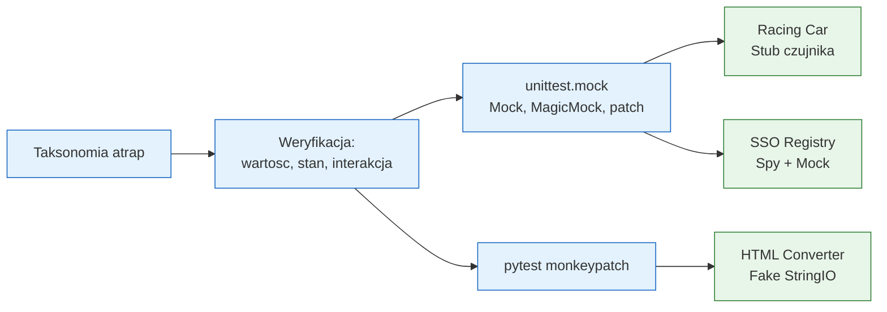

# Moduł 03 - Test Doubles w Pythonie

Moduł opisuje atrapy testowe i izolowanie testowanego komponentu od zewnętrznych
zależności. Przykłady pokazują, kiedy użyć Dummy, Stub, Fake, Spy i Mock oraz
jak odróżnić asercję wyniku, stanu i interakcji.

## Cel zajęć

Po module student powinien:

- rozróżniać pięć typów Test Doubles według xUnit Test Patterns,
- dobrać atrapę do pytania testowego, zamiast automatycznie używać `Mock`,
- stosować `unittest.mock.Mock`, `MagicMock` i `patch`,
- używać fixture `monkeypatch` w pytest,
- odróżniać asercję na wartość/wyjątek, zmianę stanu i interakcję,
- izolować czujnik, plik, zegar, klienta HTTP i rejestr SSO,
- rozpoznać, kiedy test mockujący jest zbyt szczegółowy i kruchy.

## Tematy

1. [01-test-double-taxonomy](01-test-double-taxonomy/README.md) - Dummy,
   Stub, Fake, Spy i Mock.
2. [02-verification-and-tools](02-verification-and-tools/README.md) - trzy
   kategorie weryfikacji oraz `unittest.mock` i `monkeypatch`.
3. [03-racing-car-and-html](03-racing-car-and-html/README.md) - czujnik
   ciśnienia i `io.StringIO` jako praktyczne izolowanie I/O.
4. [04-sso-registry](04-sso-registry/README.md) - Spy i Mock w rejestrze SSO.

## Mapa modułu



## Uruchamianie

```powershell
# Wszystkie testy modułu
.venv\Scripts\python.exe -m pytest src\03-test_double -c src\03-test_double\pytest.ini -v

# Wybrany temat
.venv\Scripts\python.exe -m pytest src\03-test_double\03-racing-car-and-html -v

# Ruff
.venv\Scripts\python.exe -m ruff check src\03-test_double

# Diagramy Mermaid -> PNG
.venv\Scripts\python.exe src\03-test_double\generate_diagrams.py
```

## Scenariusz 90-minutowego wykładu

| Czas | Etap | Treść |
|---|---|---|
| 0-15 min | Taksonomia | Dummy, Stub, Fake, Spy, Mock na jednej zależności |
| 15-30 min | Weryfikacja | Return value/Exception, State, Interaction |
| 30-45 min | Narzędzia | `Mock`, `MagicMock`, `patch`, `monkeypatch` |
| 45-60 min | Live coding 1 | Stub czujnika ciśnienia w samochodzie wyścigowym |
| 60-72 min | Live coding 2 | Fake `StringIO` dla konwertera HTML |
| 72-85 min | Live coding 3 | Spy i Mock w SSO Registry |
| 85-90 min | Podsumowanie | Jak nie przesmockować testów |

## Zasada wyboru atrap

Najpierw nazwij pytanie testu:

- „Jaki wynik otrzymam?” -> Stub/Fake i asercja return value/exception.
- „Jak zmienił się obiekt?” -> Fake lub prawdziwy obiekt i asercja stanu.
- „Czy zależność została wywołana?” -> Spy/Mock i asercja interakcji.

## Porównanie narzędzi: Mock vs monkeypatch vs Spy

| Narzędzie | Rola | Oczekiwania? | Automatyczna weryfikacja? | Kiedy używać |
|---|---|:---:|:---:|---|
| **unittest.mock.Mock** | Mock | ✓ | ✓ | Interakcje z dokładnym kontraktem, szybka weryfikacja |
| **unittest.mock.patch** | Mock/Stub | ✓ | ✓ | Podmiana modułów, funkcji, metod na poziomie globalnym |
| **pytest monkeypatch** | Mock/Stub | ✗ | ✗ | Zmienne środowiskowe, atrybuty, mniej restrykcyjne |
| **Spy (własny)** | Spy | ✗ | ✗ | Elastyczność, własna logika, bardziej czytelne `calls` |
| **Stub (własny)** | Stub | ✗ | ✗ | Powrót wartości, uproszczona domena |
| **Fake (własny)** | Fake | ✗ | ✗ | Działająca uproszczona implementacja (np. in-memory DB) |

**Reguła**: zacznij od `Mock`, jeśli test staje się zbyt szczegółowy → przejdź na `Spy`, jeśli potrzebujesz elastyczności → zbuduj `Fake`, jeśli wymagana jest prawdziwa logika.

## Anti-patterns: kiedy Double robi się zbyt skomplikowany

### 1. Over-mocking: mockowanie całego stosu

❌ **Źle**: Mockujesz każdy poziom aplikacji.

```python
def test_user_creation_with_all_mocks():
    db = Mock(spec=Database)
    cache = Mock(spec=Cache)
    logger = Mock(spec=Logger)
    email_service = Mock(spec=EmailService)
    service = UserService(db, cache, logger, email_service)
    # Test sprawdza 15 interakcji zamiast logiki
```

✅ **Dobrze**: Mock tylko tę zależność, której izolacja coś zmienia.

```python
def test_user_creation_sends_email():
    email_service = Mock(spec=EmailService)
    service = UserService(Database(), email_service)  # prawdziwa baza
    service.create_user("john@example.com")
    email_service.send.assert_called_once()
```

### 2. Mock brittle tests: za szczegółowe asercje

❌ **Źle**: Test załamuje się na każdej zmianie implementacji.

```python
def test_brittle():
    dependency = Mock()
    service.do_work(dependency)
    # Szczegółowa kolejność i liczba argumentów
    assert dependency.mock_calls == [
        call.validate({"id": 1}),
        call.fetch({"id": 1}),
        call.transform({"id": 1}),
        call.save({"id": 1})
    ]
```

✅ **Dobrze**: Asercja tylko na kontrakcie, nie na implementacji.

```python
def test_contract():
    dependency = Mock()
    service.do_work(dependency)
    # Ważny kontrakt: fetch musi być wywołany z ID
    dependency.fetch.assert_called_once()
    call_args = dependency.fetch.call_args[0]
    assert call_args[0]["id"] == 1
```

### 3. Fake zamiast Stub: logika, której nie potrzebujesz

❌ **Źle**: Fake staje się miniaturową wersją produkcji.

```python
class FakeDatabaseWithQueryLanguage:
    def select(self, query_string):
        # Implementujesz SQL parser...
        # Implementujesz transaction logging...
        # To już nie test, to test bazy!
```

✅ **Dobrze**: Fake zawiera tylko to, co test wymaga.

```python
class SimpleFakeDatabase:
    def __init__(self):
        self.data = {}
    
    def fetch(self, key):
        if key not in self.data:
            raise KeyError(f"Not found: {key}")
        return self.data[key]
```

### 4. Mockowanie szczegółów implementacji

❌ **Źle**: Mockujesz `_private_method`.

```python
def test_implementation_detail():
    service.internal_cache = Mock()
    service.do_work()
    service.internal_cache.put.assert_called_once()
```

✅ **Dobrze**: Testuj przez publiczny interfejs.

```python
def test_through_public_api():
    service = UserService(cache=FakeCache())
    service.find_user(123)
    assert service.find_user(123) == cached_result  # szybciej
```

### 5. Niewystarczająca izolacja: mocki tworzą złe czucie bezpieczeństwa

❌ **Źle**: Test przechodzi z mockami, ale pada w produkcji.

```python
def test_with_mocks_only():
    api = Mock()
    api.get.return_value = {"status": "ok"}
    service = ExternalAPIClient(api)
    assert service.check_health() == "healthy"

# W produkcji: ExternalAPIClient oczekuje innego formatu!
```

✅ **Dobrze**: Zintegruj co najmniej raz w pełnym teście.

```python
def test_with_integration():
    # Snapshot test z prawdziwym API
    actual_response = requests.get("https://api.example.com/health")
    assert "status" in actual_response.json()

def test_with_stub_unit():
    api = Mock()
    api.get.return_value = actual_response.json()
    service = ExternalAPIClient(api)
    assert service.check_health() == "healthy"
```

## Literatura

- Gerard Meszaros, *xUnit Test Patterns*: <http://xunitpatterns.com/Test%20Stub.html>
- Martin Fowler, *Mocks Aren't Stubs*: <https://martinfowler.com/articles/mocksArentStubs.html>
- Gerard Meszaros, *Test Double Patterns*: <http://xunitpatterns.com/Test%20Double.html>
- Python Docs - `unittest.mock`: <https://docs.python.org/3/library/unittest.mock.html>
- pytest Docs - `monkeypatch`: <https://docs.pytest.org/en/stable/how-to/monkeypatch.html>
- pytest Docs - fixtures: <https://docs.pytest.org/en/stable/how-to/fixtures.html>
