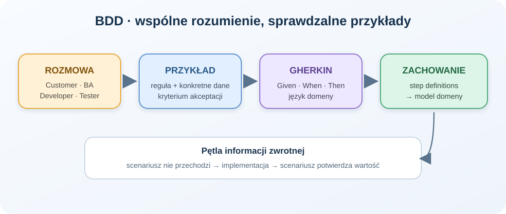
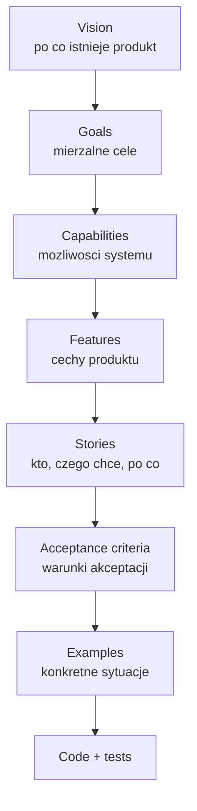
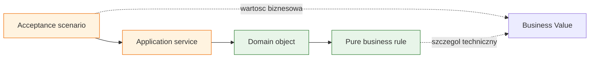

# Temat 01 - BDD i Outside-In

> Moduł: [04-BDD](../README.md) · Następny: [02-gherkin-language](../02-gherkin-language/README.md)

## Cel

Zrozumieć BDD jako praktykę rozmowy o wartości biznesowej i przykładach,
a nie jako alternatywną nazwę dla testów jednostkowych.

## Od techniki do wartości



Hierarchia wymagań:



Przykład domeny lotów:

- Vision: pasażerowie mogą bezpiecznie i przejrzyście zarządzać podróżą.
- Goal: VIP otrzymuje usługę premium i punkty lojalnościowe.
- Capability: system rozpoznaje typ lotu i status pasażera.
- Feature: Premium Flight przyjmuje tylko VIP.
- Story: „Jako operator chcę zablokować dodanie pasażera standardowego,
  aby oferta premium nie była naruszana”.
- Acceptance criterion: `Given` lot premium, `When` dodaję pasażera standardowego,
  `Then` system odrzuca operację.
- Example: konkretny pasażer `Alice`, `VIP = False`.

## Outside-In

Outside-In zaczyna od zachowania widocznego dla użytkownika lub biznesu,
a następnie schodzi do współpracujących komponentów. Acceptance test jest
zewnętrznym kontraktem; testy jednostkowe powstają wtedy, gdy implementacja
wydziela wewnętrzne reguły.



## Pętla współpracy

- **Customer** opisuje problem, cel i wartość.
- **Business Analyst** doprecyzowuje reguły i przykłady.
- **Developer** pyta o niejednoznaczności i implementuje zachowanie.
- **Tester** pomaga znaleźć przypadki brzegowe oraz automatyzuje przykłady.

BDD działa najlepiej, gdy scenariusz jest wspólnym artefaktem rozmowy, a nie
kodem napisanym wyłącznie przez jedną osobę.

## Zadania

1. Przepisz wymaganie „lot premium dla VIP” na story i trzy kryteria akceptacji.
2. Zorganizuj spotkanie Three Amigos: zapisz pytanie Customer, BA, Developera
   i Testera.
3. Wskaż, które zdanie opisuje wartość biznesową, a które implementację.
4. Dopisz scenariusz blokady duplikatu pasażera.

**Podpowiedzi:**

- używaj przykładów z konkretnymi wartościami,
- unikaj nazw klas i prywatnych metod w kryteriach biznesowych,
- każde kryterium powinno mieć jeden oczekiwany rezultat.

## Uruchomienie i debugowanie

```powershell
.venv\Scripts\python.exe -m compileall src\04-BDD\01-bdd-outside-in
.venv\Scripts\python.exe -m pytest src\04-BDD\01-bdd-outside-in -v
```

Tak — po dodaniu rozwiązań w tym temacie jest już kod Pythona:
[bdd_solutions_01.py](exercises/bdd_solutions_01.py) zawiera modelowe odpowiedzi
do zadań, a [test_bdd_solutions_01.py](exercises/test_bdd_solutions_01.py)
sprawdza ich najważniejsze elementy.

`compileall` nie kompiluje programu do osobnego pliku wykonywalnego. Python
sprawdza składnię i może utworzyć pliki bytecode `.pyc`. W tym temacie jest to
szybka kontrola poprawności składni, natomiast `pytest` uruchamia testy
rozwiązań. Plik rozwiązań można także obejrzeć bezpośrednio:

```powershell
.venv\Scripts\python.exe src\04-BDD\01-bdd-outside-in\exercises\bdd_solutions_01.py
```

## Pytania kontrolne

1. Czym różni się Feature od Capability?
2. Dlaczego przykład jest lepszy niż ogólne „system ma obsługiwać VIP”?
3. Co oznacza Outside-In?
4. Kiedy tester powinien wejść do rozmowy o wymaganiu?

## Odpowiedzi na pytania kontrolne

### 1. Czym różni się Feature od Capability?

**Capability** to szersza możliwość systemu, która wspiera cel biznesowy.
Przykładem jest „system rozpoznaje typ lotu i status pasażera”.

**Feature** to konkretny, widoczny dla użytkownika fragment tej możliwości,
który można opisać scenariuszami akceptacji. Przykładem jest „lot premium
przyjmuje tylko pasażerów VIP”. Jedna capability może obejmować wiele features.

### 2. Dlaczego przykład jest lepszy niż ogólne „system ma obsługiwać VIP”?

Ogólne wymaganie nie określa, kto wykonuje operację, jakie dane wejściowe są
ważne ani jaki rezultat jest oczekiwany. Konkretny przykład, np. „dla lotu
premium operator dodaje Alice ze statusem VIP, a Alice zostaje dodana”, usuwa
niejednoznaczność i może stać się scenariuszem `Given/When/Then`.

Przykłady ujawniają również przypadki brzegowe: pasażera standardowego,
duplikat albo brak miejsca. Dzięki temu Customer, BA, Developer i Tester
rozmawiają o tym samym zachowaniu, a nie o różnych interpretacjach hasła
„obsługa VIP”.

### 3. Co oznacza Outside-In?

Outside-In oznacza projektowanie i implementowanie systemu od zachowania
zewnętrznego do środka:

1. zaczynamy od wartości biznesowej i scenariusza akceptacji,
2. ustalamy kontrakt aplikacji widoczny dla użytkownika lub operatora,
3. schodzimy do serwisu aplikacyjnego i obiektów domenowych,
4. dopiero na końcu wydzielamy wewnętrzne reguły i komponenty techniczne.

Podejście chroni przed rozpoczęciem pracy od klas i metod, które nie
odpowiadają na rzeczywistą potrzebę biznesową. Testy jednostkowe są ważne, ale
powinny wspierać zachowanie potwierdzone przykładem zewnętrznym.

### 4. Kiedy tester powinien wejść do rozmowy o wymaganiu?

Tester powinien uczestniczyć od początku, przed implementacją. Wspólnie z
Customerem, BA i Developerem pomaga doprecyzować kryteria akceptacji, pytania
„co jeśli?” oraz dane brzegowe.

Nie chodzi wyłącznie o późniejsze znalezienie błędu. Tester może wcześniej
ujawnić niejasność, np. czy powtórne dodanie tego samego pasażera jest błędem,
oraz pomóc zapisać ją jako jednoznaczny przykład i automatyzowalny scenariusz.

## Literatura

- Dan North, *Introducing BDD*: <https://dannorth.net/introducing-bdd/>
- Martin Fowler, *Specification by Example*: <https://martinfowler.com/bliki/SpecificationByExample.html>
- Liz Keogh, *Behavior Driven Development*: <https://lizkeogh.com/behavior-driven-development/>
