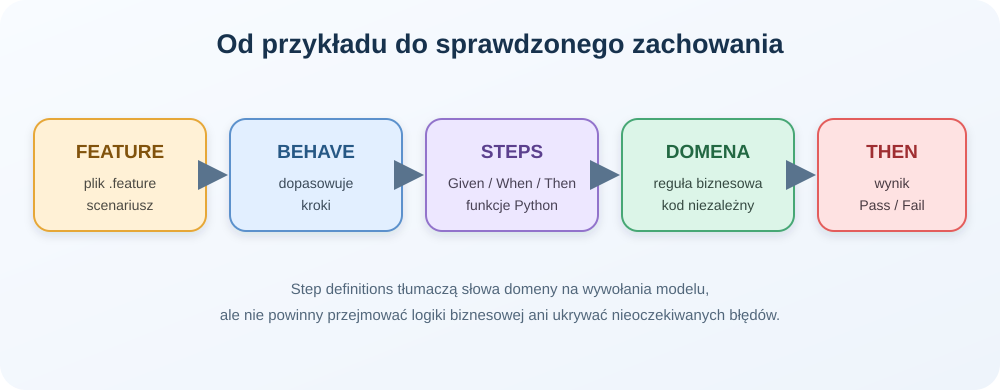
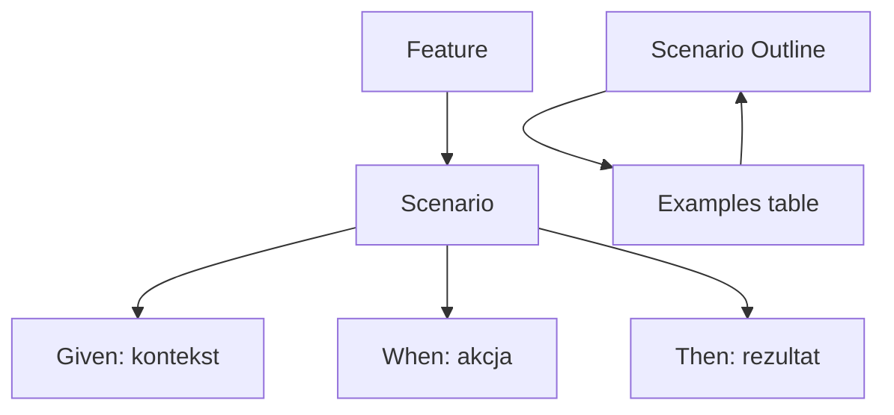

# Temat 02 - Język Gherkin

> Moduł: [04-BDD](../README.md) · Poprzedni: [01-bdd-outside-in](../01-bdd-outside-in/README.md) · Następny: [03-behave-structure](../03-behave-structure/README.md)

## Cel

Nauczyć się zapisywać wymagania jako wykonywalne przykłady zrozumiałe dla
biznesu i zespołu technicznego.

## Idea Gherkina

Gherkin jest językiem opisu zachowania systemu. Łączy trzy cele:

1. **rozmowę** - Customer, BA, Developer i Tester mogą przeczytać ten sam
   przykład i sprawdzić, czy rozumieją wymaganie tak samo,
2. **specyfikację** - scenariusz zapisuje konkretną regułę biznesową, a nie
   ogólną obietnicę typu „system obsługuje VIP”,
3. **automatyzację** - kroki mogą zostać połączone z kodem step definitions,
   więc przykład może stać się testem wykonywanym przez `behave`.

Gherkin nie jest językiem programowania i nie opisuje algorytmu. Nie mówi, czy
system ma użyć klasy `PremiumFlight`, słownika czy bazy SQL. Mówi, co
użytkownik lub operator może zaobserwować. Dzięki temu scenariusz pozostaje
stabilny, nawet gdy implementacja wewnętrzna zostanie zmieniona.

### Kim jest BA?

`BA` to skrót od **Business Analyst**, czyli **analityk biznesowy**. Jest to
osoba, która pomaga zespołowi zrozumieć problem biznesowy i przełożyć go na
jednoznaczne wymagania oraz przykłady. BA nie ogranicza się do spisywania
życzeń; dopytuje o cel, reguły, wyjątki, dane wejściowe i oczekiwane rezultaty.

W praktyce BA:

- porządkuje rozmowę między Customerem, Developerem i Testerem,
- pomaga odróżnić wartość biznesową od szczegółu implementacyjnego,
- doprecyzowuje scenariusze `Given/When/Then`,
- wykrywa sprzeczności i brakujące przypadki przed rozpoczęciem
  implementacji,
- pilnuje, aby kryteria akceptacji odpowiadały rzeczywistej potrzebie
  biznesowej.

W przykładzie lotu premium BA może zadać pytania: „Czy status `VIP` jest
jedynym warunkiem?”, „Co dzieje się, gdy lot jest pełny?” oraz „Czy
standardowy pasażer powinien zobaczyć konkretny komunikat?”. Odpowiedzi
pomagają zespołowi zapisać scenariusz, który jest zrozumiały zarówno dla
biznesu, jak i dla osoby automatyzującej test.

### Od potrzeby do przykładu

Zdanie „lot premium ma obsługiwać VIP” jest dopiero hipotezą wymagania. Aby
powstał dobry scenariusz, doprecyzuj:

- **kto** wykonuje operację,
- **jaki konkretny stan** istnieje przed operacją,
- **co dokładnie** robi użytkownik,
- **jaki widoczny rezultat** potwierdza sukces albo odrzucenie,
- **jakie dane** odróżniają ten przypadek od innych.

Porównanie:

```text
Nieprecyzyjnie: System obsługuje VIP.

Precyzyjnie: Gdy operator dodaje pasażera VIP do lotu premium z wolnym
miejscem, pasażer pojawia się na liście pasażerów.
```

Druga wersja ma aktora, warunek początkowy, akcję i obserwowalny rezultat.
Można ją omówić z biznesem, a później zapisać jako `Given/When/Then`.

## Składnia



```gherkin
Feature: Lot premium
  Aby chronić ofertę premium
  Jako operator lotu
  Chcę wpuszczać tylko pasażerów VIP

  Scenario: Standardowy pasażer nie może wejść na lot premium
    Given istnieje lot premium o numerze "PR100"
    And istnieje standardowy pasażer "Alice"
    When dodaję pasażera "Alice" do lotu
    Then operacja jest odrzucona komunikatem "only VIP passengers"
```

### Elementy

- `Feature` - nazwa i cel funkcji biznesowej,
- `Scenario` - jeden przykład zachowania,
- `Given` - kontekst początkowy,
- `When` - akcja użytkownika/systemu,
- `Then` - obserwowalny rezultat,
- `And` - kolejny krok tej samej fazy,
- `Scenario Outline` + `Examples` - ten sam scenariusz dla wielu danych.

`Given`, `When` i `Then` opisują sens kroku, a nie tylko jego kolejność:

- `Given` odpowiada na pytanie: „co musi być prawdą przed rozpoczęciem?”,
- `When` opisuje jedną akcję aktora lub systemu, która uruchamia zachowanie,
- `Then` opisuje rezultat, który można zaobserwować z zewnątrz.

`And` i `But` poprawiają czytelność, ale dziedziczą znaczenie poprzedniego
rodzaju kroku. Po `Given` kolejne `And` nadal buduje kontekst; po `Then`
kolejne `And` nadal opisuje rezultat.

Przykład dwóch różnych rezultatów:

```gherkin
Scenario: VIP zostaje dodany do lotu premium
  Given lot premium "PR100" ma wolne miejsce
  And pasażer "Alice" ma status VIP
  When operator dodaje pasażera "Alice" do lotu
  Then pasażer "Alice" jest widoczny na liście lotu

Scenario: Standardowy pasażer zostaje odrzucony
  Given lot premium "PR100" ma wolne miejsce
  And pasażer "Bob" ma status STANDARD
  When operator dodaje pasażera "Bob" do lotu
  Then operator widzi komunikat "only VIP passengers"
  And pasażer "Bob" nie jest na liście lotu
```

Pierwszy scenariusz opisuje sukces, a drugi zabezpiecza regułę negatywną.
Oba są krótkie, używają tych samych pojęć domenowych i nie ujawniają nazw
metod ani pól obiektów.

## Szkic scenariusza i formalna specyfikacja

Przed zapisaniem Gherkina warto przygotować krótki szkic w języku rozmowy:

```text
Cel: chronić ofertę premium przed nieuprawnionym pasażerem.
Aktor: operator lotu.
Początek: istnieje lot premium PR200 z wolnym miejscem,
          a Alice jest pasażerem standardowym.
Akcja: operator próbuje dodać Alice do lotu.
Rezultat: operacja zostaje odrzucona, Alice nie trafia na listę,
          a operator otrzymuje jasny komunikat.
```

Szkic nie jest jeszcze testem. Pomaga uzgodnić regułę z biznesem i znaleźć
brakujące informacje. Po uzgodnieniu można zapisać formalną specyfikację:

```gherkin
@premium @negative
Feature: Ochrona dostępu do lotu premium
  Aby oferta premium była dostępna tylko dla uprawnionych osób
  Jako operator lotu
  Chcę odrzucać standardowych pasażerów

  Scenario: Standardowy pasażer nie zostaje dodany do lotu premium
    Given lot premium "PR200" ma wolne miejsce
    And pasażer "Alice" ma status "STANDARD"
    When operator dodaje pasażera "Alice" do lotu
    Then operacja zostaje odrzucona
    And operator widzi komunikat "only VIP passengers"
    And pasażer "Alice" nie jest na liście lotu
```

### Dlaczego ta specyfikacja jest użyteczna?

- `Feature` wyjaśnia wartość biznesową i rolę operatora.
- `Scenario` wybiera jeden konkretny przykład, zamiast mieszać kilka reguł.
- `Given` przygotowuje tylko dane potrzebne do tego przykładu.
- `When` opisuje działanie operatora, a nie wywołanie metody Pythona.
- `Then` sprawdza trzy konsekwencje widoczne dla użytkownika: odrzucenie,
  komunikat i brak pasażera na liście.
- Tag `@premium` pozwala później uruchomić scenariusze wybranej funkcji,
  a `@negative` wyróżnia przypadki odrzucenia.

### Kiedy użyć `Scenario Outline`?

Jeśli reguła jest taka sama, a zmieniają się tylko dane i wynik, nie kopiuj
kilku niemal identycznych scenariuszy. Użyj tabeli przykładów:

```gherkin
Scenario Outline: Dostęp do lotu premium zależy od statusu
  Given lot premium "PR300" ma wolne miejsce
  And pasażer "Alex" ma status "<status>"
  When operator dodaje pasażera "Alex" do lotu
  Then operacja jest "<result>"

  Examples:
    | status   | result     |
    | VIP      | zaakceptowana |
    | STANDARD | odrzucona     |
```

Outline nie służy do ukrywania różnych reguł w jednej tabeli. Jeżeli przykłady
mają inne akcje albo inne znaczenie biznesowe, lepiej napisać dwa osobne
scenariusze.

```gherkin
Scenario Outline: Punkty promocyjne zależą od statusu
  Given pasażer ma status "<status>"
  And lot ma przebieg <mileage> km
  When naliczam punkty
  Then pasażer otrzymuje <points> punktów

  Examples:
    | status   | mileage | points |
    | VIP      | 1000    | 100    |
    | STANDARD | 1000    | 50     |
```



## Dobre scenariusze

- opisują zachowanie, nie strukturę klas,
- mają jedną intencję biznesową,
- używają języka domeny,
- mają konkretny rezultat,
- nie ukrywają wielu akcji w jednym `When`.

Dodatkowe wskazówki:

- używaj nazw domenowych (`pasażer`, `lot premium`, `status VIP`), a nie
  technicznych (`obiekt`, `fixture`, `endpoint`),
- podawaj dane tylko wtedy, gdy wpływają na wynik,
- nie twórz scenariusza z dziesięcioma krokami przygotowującymi; wyodrębnij
  wspólny kontekst albo uprość przykład,
- nie asertywuj logów, wywołań prywatnych metod ani rozmiaru wewnętrznej
  kolekcji, jeśli użytkownik tego nie widzi,
- komunikat błędu powinien być częścią scenariusza tylko wtedy, gdy jest
  kontraktem ważnym dla operatora lub użytkownika.

Zły scenariusz:

```gherkin
When wywołuję metodę add_passenger z obiektem Passenger
Then pole _passengers ma długość 1
```

Dobry scenariusz:

```gherkin
When dodaję pasażera do lotu
Then pasażer jest na liście pasażerów lotu
```

## Zadania

1. Napisz Feature dla lotu ekonomicznego.
2. Przepisz trzy testy parametryczne na `Scenario Outline`.
3. Znajdź w swoim scenariuszu krok zawierający szczegół implementacyjny i usuń go.
4. Dodaj scenariusz negatywny z komunikatem błędu.

**Podpowiedzi:**

- `When` powinien opisywać akcję, nie wywołanie Pythona,
- `Then` powinien być możliwy do zaobserwowania przez użytkownika,
- tabela `Examples` powinna zawierać tylko dane zmieniające wynik.

## Uruchomienie

```bash
.venv\Scripts\python.exe -m behave src\04-BDD\04-passenger-flights\features --dry-run
```

## Pytania kontrolne

1. Kiedy użyć `Scenario Outline`?
2. Czym różni się `Given` od `When`?
3. Dlaczego prywatne pole w `Then` łamie ideę BDD?
4. Jak scenariusz pomaga BA i developerowi rozmawiać o tym samym wymaganiu?

## Literatura

- Cucumber Docs - Gherkin Reference: <https://cucumber.io/docs/gherkin/reference>
- Behave Docs - Gherkin: <https://behave.readthedocs.io/en/latest/gherkin/>
- Gojko Adzic, *Specification by Example*, Manning, 2011.
