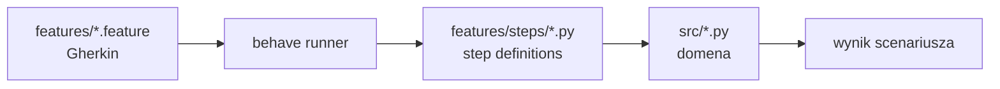
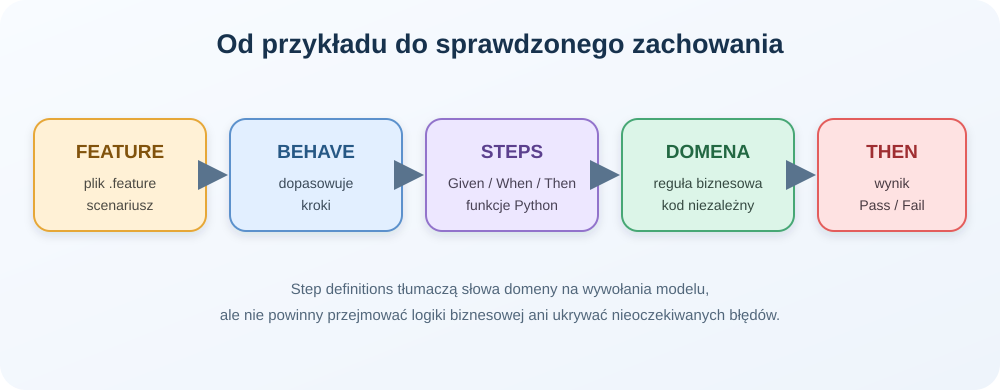

# Temat 03 - Struktura projektu Behave

> Moduł: [04-BDD](../README.md) · Poprzedni: [02-gherkin-language](../02-gherkin-language/README.md) · Następny: [04-passenger-flights](../04-passenger-flights/README.md)

## Cel

Zrozumieć, jak Behave odnajduje scenariusze i dopasowuje kroki Gherkina do
funkcji Python.

## Struktura katalogów

```text
04-passenger-flights/
├── features/
│   ├── economy_flight.feature
│   ├── premium_flight.feature
│   ├── bonus_points.feature
│   ├── environment.py
│   └── steps/
│       └── passenger_steps.py
├── src/
│   └── flight_domain.py
├── exercises/
└── README.md
```



Przepływ w skrócie: plik `.feature` opisuje przykład, Behave dopasowuje każdy
krok do dekorowanej funkcji Python, a step definition wywołuje model domeny.
Wynik Then powinien sprawdzać obserwowalne zachowanie, nie prywatne pola.



## Jak Behave znajduje i wykonuje scenariusz?

Behave rozpoczyna pracę w katalogu `features`. Wyszukuje pliki z rozszerzeniem
`.feature`, odczytuje ich `Feature`, `Scenario` i kroki, a następnie ładuje
Pythonowe pliki z katalogu `features/steps`. Dekoratory `@given`, `@when` i
`@then` rejestrują wzorce, które Behave porównuje z tekstem kroków.

Dla scenariusza:

```gherkin
Given istnieje lot ekonomiczny o numerze "EC100"
When dodaję pasażera "Alice" do lotu
```

Behave wykonuje kolejno funkcje podobne do tych:

```python
@given('istnieje lot ekonomiczny o numerze "{number}"')
def economy_flight(context, number: str) -> None:
    context.flight = EconomyFlight(number, mileage=1000)


@when('dodaję pasażera "{name}" do lotu')
def add_passenger(context, name: str) -> None:
    context.flight.add_passenger(context.passengers[name])
```

Tekst w cudzysłowie jest parametrem. W pierwszym kroku `number` otrzyma
wartość `"EC100"`, a w drugim `name` otrzyma `"Alice"`. Funkcja kroku nie
jest wywoływana ręcznie z pliku `.feature`; wywołuje ją runner Behave po
dopasowaniu dekoratora.

Kolejność wykonania jednego scenariusza:

1. Behave tworzy kontekst scenariusza.
2. Uruchamia hooki, np. `before_scenario`.
3. Wykonuje kroki `Given`, `When` i `Then` w kolejności z pliku.
4. Przekazuje parametry z tekstu do funkcji step definition.
5. Zatrzymuje scenariusz po błędzie kroku i raportuje miejsce awarii.
6. Uruchamia hooki sprzątające, np. `after_scenario`.

## Rola poszczególnych plików

### Plik `.feature`

Zawiera język biznesowy i przykłady. Nie powinien importować Pythona ani
wyjaśniać, jak przechowywana jest lista pasażerów.

```gherkin
Feature: Lot premium

  Scenario: VIP może wejść na lot
    Given istnieje lot premium o numerze "PR100"
    And istnieje pasażer VIP "Victor"
    When dodaję pasażera "Victor" do lotu
    Then pasażer "Victor" jest na locie
```

### `features/steps/`

Zawiera cienką warstwę adaptera. Step definition tłumaczy zdanie Gherkina na
wywołanie domeny, ale nie powinien sam implementować reguły „tylko VIP może
wejść na lot premium”.

```python
@then('pasażer "{name}" jest na locie')
def passenger_is_on_flight(context, name: str) -> None:
    assert context.flight.has_passenger(name)
```

Reguła dostępu należy do `PremiumFlight`, dzięki czemu może być użyta również
przez kod aplikacji albo zwykły test jednostkowy, bez uruchamiania Behave.

### `environment.py`

To miejsce na konfigurację cyklu życia testów: ścieżkę do kodu, klienta API,
połączenie z bazą, raportowanie i sprzątanie. Nie należy przenosić do hooków
całej logiki scenariusza, bo wtedy jego warunki przestają być widoczne w
pliku `.feature`.

```python
def before_scenario(context, scenario):
    context.flight = None
    context.error = None


def after_scenario(context, scenario):
    if scenario.status == "failed":
        print(f"Nieudany scenariusz: {scenario.name}")
```

Hook `before_scenario` przygotowuje wspólny techniczny kontekst, natomiast
konkretne dane biznesowe, np. numer lotu i pasażera, powinny zwykle pojawić
się w krokach `Given`.

### `context` - pamięć jednego scenariusza

`context` jest obiektem przekazywanym do hooków i wszystkich funkcji kroków.
Pozwala przekazać wynik z `Given` do `When`, a następnie do `Then`:

```python
@given('istnieje pasażer VIP "{name}"')
def vip_passenger(context, name: str) -> None:
    context.passenger = Passenger(name, vip=True)


@when('dodaję pasażera do lotu')
def add_passenger(context) -> None:
    context.flight.add_passenger(context.passenger)


@then('pasażer jest na locie')
def passenger_is_on_flight(context) -> None:
    assert context.flight.has_passenger(context.passenger.name)
```

`context` nie jest globalnym magazynem. Behave tworzy izolowany kontekst dla
scenariusza, dlatego dane jednego scenariusza nie powinny wpływać na następny.
Jeśli kilka kroków potrzebuje wielu pasażerów, czytelniej jest użyć jawnego
`context.passengers` jako słownika zainicjalizowanego w `Given`.

## Parametry i dopasowanie kroków

Behave może przekazywać parametry jako tekst albo konwertować je za pomocą
matchera:

```python
@given('przebieg lotu wynosi {mileage:d} kilometrów')
def mileage(context, mileage: int) -> None:
    context.flight = EconomyFlight("POINTS", mileage=mileage)
```

`{mileage:d}` oznacza liczbę całkowitą, więc krok
`Given przebieg lotu wynosi 1000 kilometrów` przekazuje `1000`, a nie `"1000"`.
Bez konwersji krok musiałby sam wykonać `int(mileage)`.

Dla danych tabelarycznych można użyć tabeli Gherkina:

```gherkin
Given lot ma następujących pasażerów:
  | name  | status   |
  | Alice | STANDARD |
  | Victor| VIP      |
```

```python
@given("lot ma następujących pasażerów:")
def passengers_table(context) -> None:
    context.passengers = {
        row["name"]: Passenger(row["name"], vip=row["status"] == "VIP")
        for row in context.table
    }
```

Tabela jest dobrym rozwiązaniem, gdy wiele wierszy należy do jednego
kontekstu. Nie należy używać jej do ukrywania kilku niezależnych zachowań w
jednym kroku.

## Tagi i wybieranie scenariuszy

Tagi pozwalają uruchomić fragment zestawu:

```gherkin
@premium @negative
Scenario: Standardowy pasażer nie może wejść na lot premium
  ...
```

```powershell
python -m behave --tags=@premium
python -m behave --tags="@premium and not @slow"
```

Tag `@premium` może oznaczać funkcję biznesową, a `@slow` test wymagający
zewnętrznego zasobu. Tag nie zastępuje dobrej nazwy scenariusza i nie powinien
być używany do ukrywania niepewnych testów.

## Typowe błędy i lepsze rozwiązania

### Zbyt techniczny krok

```gherkin
When wywołuję metodę add_passenger z obiektem Passenger
Then lista _passengers ma długość 1
```

Lepsza wersja opisuje działanie operatora i rezultat domenowy:

```gherkin
When operator dodaje pasażera do lotu
Then pasażer jest widoczny na liście lotu
```

### Logika biznesowa w step definition

Nie należy implementować reguły w kroku:

```python
@when('dodaję pasażera VIP do lotu')
def add_vip(context):
    if not context.passenger.vip:
        context.error = "only VIP passengers"
    else:
        context.flight.passengers.append(context.passenger)
```

To omija model domeny i może sprawić, że test przejdzie mimo błędu produkcyjnej
klasy. Lepszy krok wywołuje publiczną operację:

```python
@when('dodaję pasażera do lotu')
def add_passenger(context):
    try:
        context.flight.add_passenger(context.passenger)
    except FlightError as error:
        context.error = error
```

### Stan tworzony w `Then`

`Then` powinien sprawdzać wynik operacji wykonanej w `When`, a nie wykonywać ją
ponownie. Jeśli `Then` sam dodaje pasażera albo tworzy nowy lot, test może
potwierdzać stan przygotowany przez asercję, a nie prawdziwe zachowanie.

```powershell
Push-Location src\04-BDD\04-passenger-flights
..\..\..\.venv\Scripts\python.exe -m behave -f pretty
..\..\..\.venv\Scripts\python.exe -m behave --dry-run
..\..\..\.venv\Scripts\python.exe -m behave --tags=@premium
Pop-Location
```

### Dopasowanie kroków

```python
@given('istnieje lot ekonomiczny o numerze "{flight_number}"')
def step_economy_flight(context, flight_number):
    context.flight = EconomyFlight(flight_number, mileage=1000)
```

Tekst dekoratora jest kontraktem z Gherkinem. Placeholder `{flight_number}`
trafia do argumentu funkcji. `context` jest obiektem scenariusza i nie powinien
być używany jako globalny magazyn między scenariuszami.

### `environment.py`

Służy do przygotowania i sprzątania zasobów. Dla prostych scenariuszy można
ustawić dane w kroku `Given`; fixture-like hooks przydają się przy bazach,
klientach i raportowaniu.

```python
def before_scenario(context, scenario):
    context.flight = None
```

## Zadania

1. Dodaj krok `Then` sprawdzający liczbę pasażerów.
2. Dopasuj parametr liczbowy i zweryfikuj konwersję do `int`.
3. Dodaj hook zapisujący nazwę nieudanego scenariusza.
4. Przenieś powtarzalne dane do `background` albo helpera.
5. Znajdź krok zbyt techniczny i przepisz go na język domeny.

**Podpowiedzi:**

- definicja kroku powinna być krótka, logika należy do domeny,
- nie twórz nowych obiektów w `Then`, jeśli wynik ma pochodzić z `When`,
- `context` przechowuje dane jednego scenariusza.

## Uruchamialna seria przykładów

W katalogu [examples](examples) znajduje się mały projekt Behave, który można
uruchomić niezależnie od większej domeny lotów:

```text
examples/
├── flight_model.py
└── features/
    ├── basic_flight.feature
    ├── advanced_flight.feature
    ├── environment.py
    └── steps/
        └── flight_steps.py
```

### Przykład 1: minimalny przepływ `Given` → `When` → `Then`

W [basic_flight.feature](examples/features/basic_flight.feature) `Given`
tworzy lot i pasażera, `When` wywołuje operację domenową, a `Then` sprawdza
liczbę pasażerów i ich obecność na liście. Dane utworzone w `Given` są
przechowywane w `context.flight` oraz `context.passengers`.

```gherkin
Scenario: Operator dodaje pasażera do lotu
  Given istnieje lot "EC-DEMO" z 2 miejscami
  And pasażer "Alice" ma status "STANDARD"
  When operator dodaje pasażera "Alice" do lotu
  Then lot ma 1 pasażera
  And pasażer "Alice" jest na liście
```

Odpowiadające kroki w
[flight_steps.py](examples/features/steps/flight_steps.py) nie zawierają
reguły pojemności lotu. Wywołują `Flight.add_passenger`, więc ten sam model
może być testowany poza Behave.

### Przykład 2: parametry konwertowane przed wywołaniem kroku

Krok:

```python
@given('istnieje lot "{number}" z {capacity:d} miejscami i przebiegiem {mileage:d} km')
def create_flight_with_mileage(context, number, capacity, mileage):
    context.flight = Flight(number, capacity, mileage=mileage)
```

obsługuje tekst:

```gherkin
Given istnieje lot "EC-101" z 3 miejscami i przebiegiem 1000 km
```

Matcher `:d` przekazuje `capacity` i `mileage` jako `int`. Dzięki temu step
definition nie musi ręcznie konwertować napisów przez `int(...)`.

### Przykład 3: `Scenario Outline` używa tego samego kroku wiele razy

W [advanced_flight.feature](examples/features/advanced_flight.feature) dwa
wiersze tabeli uruchamiają tę samą sekwencję kroków dla innych statusów:

```gherkin
Scenario Outline: Punkty zależą od statusu pasażera
  Given istnieje lot "<flight>" z 3 miejscami i przebiegiem <mileage> km
  And pasażer "Alex" ma status "<status>"
  When obliczam punkty dla pasażera "Alex"
  Then pasażer otrzymuje <points> punktów

  Examples:
    | flight | mileage | status   | points |
    | EC-101 | 1000    | STANDARD | 100    |
    | EC-102 | 1000    | VIP      | 200    |
```

To nadal jest jeden kontrakt biznesowy. Zmieniają się tylko dane wejściowe i
oczekiwany wynik; step definitions pozostają te same.

### Przykład 4: tabela trafia do `context.table`

Tabela Gherkina jest dostępna w kroku przez `context.table`:

```python
@given("lot ma następujących pasażerów:")
def create_passengers_from_table(context):
    context.passengers = {
        row["name"]: Passenger(row["name"], row["status"])
        for row in context.table
    }
```

Każdy `row` zachowuje nazwy kolumn `name` i `status`. Tabela jest wygodna do
przekazania wielu danych jednego rodzaju, ale nie powinna ukrywać wielu
niezależnych akcji.

### Przykład 5: hook izoluje scenariusze

W [environment.py](examples/features/environment.py) `before_scenario`
tworzy pusty stan:

```python
def before_scenario(context, scenario):
    context.flight = None
    context.passengers = {}
    context.error = None
```

Każdy scenariusz zaczyna z własnym `context`, więc pasażerowie utworzeni w
jednym scenariuszu nie przechodzą do następnego. `after_scenario` pokazuje
miejsce, w którym można zwolnić klienta API, zamknąć połączenie albo zapisać
informację o wyniku.

### Uruchomienie przykładów

Z katalogu repozytorium:

```powershell
.venv\Scripts\python.exe -m behave src\04-BDD\03-behave-structure\examples\features -f pretty
.venv\Scripts\python.exe -m behave src\04-BDD\03-behave-structure\examples\features --tags=@structure
```

Pierwsze polecenie uruchamia wszystkie przykłady, a drugie filtruje je po
tagu. `--dry-run` sprawdza dopasowanie kroków bez wykonywania logiki:

```powershell
.venv\Scripts\python.exe -m behave src\04-BDD\03-behave-structure\examples\features --dry-run
```

## Uruchomienie i debugowanie

```powershell
Push-Location src\04-BDD\04-passenger-flights
..\..\..\.venv\Scripts\python.exe -m behave -f pretty
..\..\..\.venv\Scripts\python.exe -m behave --dry-run
..\..\..\.venv\Scripts\python.exe -m behave --tags=@premium
Pop-Location
```

Breakpointy ustawiaj w `features/steps/passenger_steps.py` oraz
`src/flight_domain.py`. W VS Code uruchamiaj Behave jako bieżący plik przez
konfigurację terminala lub polecenie `python -m behave`.

## Pytania kontrolne

1. Jak Behave znajduje pliki `.feature`?
2. Jak placeholder Gherkina trafia do funkcji kroku?
3. Do czego służy `context`?
4. Dlaczego logika biznesowa nie powinna być zakodowana wyłącznie w steps?
5. Kiedy użyć hooka `before_scenario`?

## Rozszerzone odpowiedzi na pytania kontrolne

### 1. Jak Behave znajduje pliki `.feature`?

Behave traktuje wskazany katalog jako katalog features. Na przykład polecenie:

```powershell
python -m behave src\04-BDD\03-behave-structure\examples\features
```

powoduje wyszukanie w tym katalogu plików `.feature`. Zawartość tych plików
jest parsowana jako `Feature`, `Scenario`, `Scenario Outline` i kroki.
Następnie Behave ładuje `environment.py` oraz moduły Python z podkatalogu
`features\steps`.

Nie wystarczy umieścić pliku z krokami obok pliku `.feature`. Behave szuka
definicji w konwencjonalnym katalogu `steps`; dlatego w przykładzie plik
[flight_steps.py](examples/features/steps/flight_steps.py) znajduje się
właśnie w `features/steps`.

Po znalezieniu scenariusza Behave porównuje tekst każdego kroku z wzorcami
zarejestrowanymi przez dekoratory `@given`, `@when` i `@then`. Jeżeli wzorca
brakuje, krok jest oznaczony jako undefined. Jeżeli pasuje więcej niż jeden
wzorzec, trzeba usunąć niejednoznaczność. `--dry-run` jest przydatny do
sprawdzenia mapowania kroków, ale nie wykonuje ich logiki.

### 2. Jak placeholder Gherkina trafia do funkcji kroku?

Placeholder jest częścią wzorca dekoratora. Przykład:

```python
@given('istnieje lot "{number}" z {capacity:d} miejscami')
def create_flight(context, number: str, capacity: int) -> None:
    context.flight = Flight(number, capacity)
```

Dla kroku:

```gherkin
Given istnieje lot "EC-DEMO" z 2 miejscami
```

Behave wywoła funkcję mniej więcej tak:

```python
create_flight(context, number="EC-DEMO", capacity=2)
```

Tekst w cudzysłowie jest pobierany jako napis, a konwerter `:d` zamienia
parametr na liczbę całkowitą. Dzięki temu step definition może od razu
przekazać `capacity` do modelu domeny. Warto pamiętać, że nazwa placeholdera
oraz nazwa argumentu funkcji muszą odpowiadać sobie semantycznie; dodatkowe
argumenty funkcji nie zostaną automatycznie uzupełnione.

Parametry `Scenario Outline`, takie jak `<status>` i `<points>`, są najpierw
podstawiane wartościami z wiersza `Examples`, a dopiero później cały krok jest
dopasowywany do dekoratora. Tabela scenariusza działa inaczej: jej dane są
dostępne w `context.table`.

### 3. Do czego służy `context`?

`context` jest obiektem przekazywanym przez Behave do hooków i funkcji kroków.
Służy do przekazania stanu scenariusza między krokami:

1. `Given` zapisuje lot w `context.flight`,
2. kolejny `Given` zapisuje pasażerów w `context.passengers`,
3. `When` odczytuje te obiekty i wywołuje operację,
4. `Then` odczytuje wynik albo błąd i wykonuje asercję.

W przykładzie:

```python
context.flight = Flight(number, capacity)
context.passengers[name] = Passenger(name, status)
context.error = error
```

`context` ma zakres scenariusza. Nie powinien zastępować bazy danych,
globalnego cache ani modułu konfiguracyjnego. Nie należy też zakładać, że
atrybut ustawiony w jednym scenariuszu będzie dostępny w następnym. Wspólny
techniczny zasób można przygotować w hooku, ale dane konkretnego przykładu
powinny być widoczne w `Given`.

### 4. Dlaczego logika biznesowa nie powinna być zakodowana wyłącznie w steps?

Step definition jest adapterem między językiem Gherkina a kodem domeny. Jeżeli
zakodujemy w nim regułę, np. „tylko VIP może wejść na lot”, otrzymamy logikę
dostępną tylko podczas uruchamiania Behave. Inny klient aplikacji może wtedy
ominąć tę regułę, a test akceptacyjny może dawać fałszywe poczucie
bezpieczeństwa.

Złe rozwiązanie:

```python
if not context.passenger.vip:
    context.error = "only VIP passengers"
else:
    context.flight.passengers.append(context.passenger)
```

Lepsze rozwiązanie deleguje decyzję do modelu:

```python
try:
    context.flight.add_passenger(context.passenger)
except FlightError as error:
    context.error = error
```

Wtedy `Flight` może być użyty przez aplikację i test jednostkowy, a Behave
sprawdza tylko zewnętrzne zachowanie. Step definition pozostaje krótki,
czytelny i mniej podatny na duplikowanie reguł.

### 5. Kiedy użyć hooka `before_scenario`?

`before_scenario` należy stosować do przygotowania technicznego stanu przed
każdym scenariuszem, np.:

- wyzerowania obiektów w `context`,
- utworzenia klienta testowego lub połączenia z bazą,
- ustawienia wspólnej konfiguracji,
- zapisania metadanych potrzebnych raportowi.

Przykład:

```python
def before_scenario(context, scenario):
    context.flight = None
    context.passengers = {}
    context.error = None
```

Nie powinno się umieszczać w nim całego zachowania biznesowego, np. dodawania
konkretnej Alice do lotu. Taki warunek przestałby być widoczny w pliku
`.feature`, a scenariusz straciłby wartość dokumentacyjną.

Jeżeli zasób trzeba zwolnić, pasuje do tego `after_scenario`, np. zamknięcie
połączenia lub usunięcie danych testowych. Hook jest właściwy także wtedy, gdy
każdy scenariusz musi mieć czysty stan; nie należy jednak używać go do
ukrywania zależności między scenariuszami.

## Literatura

- Behave Documentation: <https://behave.readthedocs.io/en/latest/>
- Behave - step matchers: <https://behave.readthedocs.io/en/latest/api/#step-functions>
- Cucumber Docs - step definitions: <https://cucumber.io/docs/cucumber/step-definitions/>
