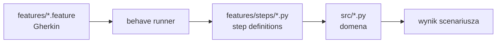
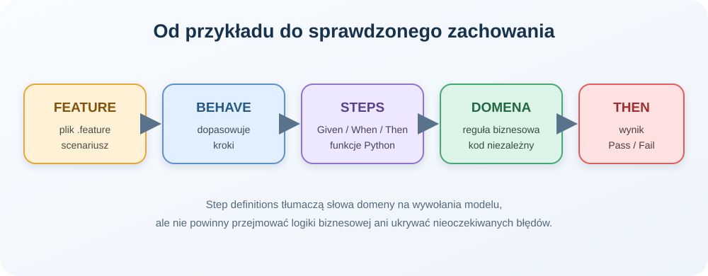

# Temat 03 - Struktura projektu Behave

> Moduł: [04-BDD](../README.md) · Poprzedni: [02-gherkin-language](../02-gherkin-language/README.md) · Następny: [04-passenger-flights](../04-passenger-flights/README.md)

## Cel

Zrozumieć, jak Behave odnajduje scenariusze i dopasowuje kroki Gherkina do
funkcji Python.

## Struktura katalogów

```text
04-passenger-flights/
├── features/
│   ├── economy_flight.feature
│   ├── premium_flight.feature
│   ├── bonus_points.feature
│   ├── environment.py
│   └── steps/
│       └── passenger_steps.py
├── src/
│   └── flight_domain.py
├── exercises/
└── README.md
```



Przepływ w skrócie: plik `.feature` opisuje przykład, Behave dopasowuje każdy
krok do dekorowanej funkcji Python, a step definition wywołuje model domeny.
Wynik Then powinien sprawdzać obserwowalne zachowanie, nie prywatne pola.



```powershell
Push-Location src\04-BDD\04-passenger-flights
..\..\..\.venv\Scripts\python.exe -m behave -f pretty
..\..\..\.venv\Scripts\python.exe -m behave --dry-run
..\..\..\.venv\Scripts\python.exe -m behave --tags=@premium
Pop-Location
```

### Dopasowanie kroków

```python
@given('istnieje lot ekonomiczny o numerze "{flight_number}"')
def step_economy_flight(context, flight_number):
    context.flight = EconomyFlight(flight_number, mileage=1000)
```

Tekst dekoratora jest kontraktem z Gherkinem. Placeholder `{flight_number}`
trafia do argumentu funkcji. `context` jest obiektem scenariusza i nie powinien
być używany jako globalny magazyn między scenariuszami.

### `environment.py`

Służy do przygotowania i sprzątania zasobów. Dla prostych scenariuszy można
ustawić dane w kroku `Given`; fixture-like hooks przydają się przy bazach,
klientach i raportowaniu.

```python
def before_scenario(context, scenario):
    context.flight = None
```

## Zadania

1. Dodaj krok `Then` sprawdzający liczbę pasażerów.
2. Dopasuj parametr liczbowy i zweryfikuj konwersję do `int`.
3. Dodaj hook zapisujący nazwę nieudanego scenariusza.
4. Przenieś powtarzalne dane do `background` albo helpera.
5. Znajdź krok zbyt techniczny i przepisz go na język domeny.

**Podpowiedzi:**

- definicja kroku powinna być krótka, logika należy do domeny,
- nie twórz nowych obiektów w `Then`, jeśli wynik ma pochodzić z `When`,
- `context` przechowuje dane jednego scenariusza.

## Uruchomienie i debugowanie

```powershell
Push-Location src\04-BDD\04-passenger-flights
..\..\..\.venv\Scripts\python.exe -m behave -f pretty
..\..\..\.venv\Scripts\python.exe -m behave --dry-run
..\..\..\.venv\Scripts\python.exe -m behave --tags=@premium
Pop-Location
```

Breakpointy ustawiaj w `features/steps/passenger_steps.py` oraz
`src/flight_domain.py`. W VS Code uruchamiaj Behave jako bieżący plik przez
konfigurację terminala lub polecenie `python -m behave`.

## Pytania kontrolne

1. Jak Behave znajduje pliki `.feature`?
2. Jak placeholder Gherkina trafia do funkcji kroku?
3. Do czego służy `context`?
4. Dlaczego logika biznesowa nie powinna być zakodowana wyłącznie w steps?
5. Kiedy użyć hooka `before_scenario`?

## Literatura

- Behave Documentation: <https://behave.readthedocs.io/en/latest/>
- Behave - step matchers: <https://behave.readthedocs.io/en/latest/api/#step-functions>
- Cucumber Docs - step definitions: <https://cucumber.io/docs/cucumber/step-definitions/>
