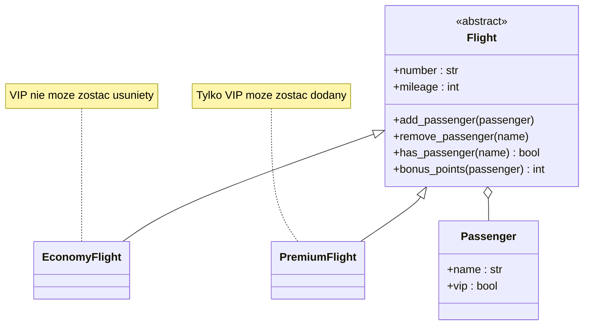

# Temat 04 - Polityka pasażerów i lotów

> Moduł: [04-BDD](../README.md) · Poprzedni: [03-behave-structure](../03-behave-structure/README.md)

## Cel

Przeprowadzić kompletne Outside-In dla domeny lotów. Scenariusze opisują
wartość biznesową, a step definitions tłumaczą Gherkin na wywołania modelu
Python.

## Features domenowe

- **Economy Flight**
  - dodawanie zwykłego pasażera,
  - usuwanie zwykłego pasażera,
  - VIP nie może zostać usunięty z lotu ekonomicznego,
  - ten sam pasażer nie może być dodany ponownie.
- **Premium Flight**
  - tylko VIP może zostać dodany.
- **Bonus Points**
  - VIP: `mileage // 10`,
  - STUDENT: `mileage // 15`,
  - standard: `mileage // 20` (wynik jest zaokrąglany w dół do całkowitej liczby punktów).



## Outside-In: scenariusz do domeny

```gherkin
Scenario: VIP nie może zostać usunięty z lotu ekonomicznego
  Given istnieje lot ekonomiczny o numerze "EC100"
  And istnieje pasażer VIP "Victor"
  And pasażer "Victor" jest na locie
  When usuwam pasażera "Victor" z lotu
  Then operacja jest odrzucona komunikatem "VIP passengers cannot be removed"
```

Scenariusz nie zna klasy `EconomyFlight` ani pola `_passengers`. Zna regułę,
która ma znaczenie dla biznesu. Dopiero step definition wybiera implementację.

## Od przykładu do sprawdzonego zachowania

Outside-In nie zaczyna się od napisania klasy. Zaczyna się od pytania:
**jakie zachowanie ma mieć wartość dla użytkownika lub operatora?** W tym
temacie przechodzimy przez następujące etapy:

| Etap | Wejście | Praca zespołu | Wyjście |
|---|---|---|---|
| 1. Potrzeba biznesowa | cel operatora i reguła domeny | doprecyzowanie aktora, warunku i wartości | zdanie biznesowe |
| 2. Konkretny przykład | dane, np. `Bob`, `EC101`, `STANDARD` | wybranie jednego przypadku, także negatywnego | przykład z oczekiwanym rezultatem |
| 3. Specyfikacja Gherkin | przykład biznesowy | zapis `Feature`, `Scenario`, `Given/When/Then` | czytelny kontrakt akceptacyjny |
| 4. Step definitions | tekst kroków i parametry | zamiana zdań na wywołania aplikacji/domeny | obiekty w `context`, wynik lub wyjątek |
| 5. Model domeny | obiekt i operacja, np. `remove_passenger` | wykonanie reguły bez wiedzy o Behave | zmieniony stan albo błąd domenowy |
| 6. Sprawdzenie | rezultat kroku `Then` | porównanie wyniku z kontraktem | `passed` albo informacja o różnicy |
| 7. Test jednostkowy | pojedyncza reguła i małe dane | szybkie sprawdzenie modelu bez runnera BDD | precyzyjny feedback dla developera |

Ważne jest rozróżnienie wejścia i wyjścia. `Given` nie powinien sam udawać
wyniku, `When` powinien wykonać akcję, a `Then` powinien tylko odczytać
rezultat. Przykładowo krok `Then pasażer "Bob" nie jest na locie` ma jako
wejście stan utworzony przez `When`, a jako wyjście asercję `True` albo
czytelny błąd testu.

### Scenariusz A: usunięcie zwykłego pasażera

**Przykład biznesowy**

```text
Operator ma lot ekonomiczny EC101, na którym znajduje się standardowy Bob.
Po usunięciu Bob nie powinien być już na liście pasażerów.
```

**Specyfikacja Gherkin**

```gherkin
Scenario: Usunięcie zwykłego pasażera z lotu ekonomicznego
  Given istnieje lot ekonomiczny o numerze "EC101"
  And istnieje standardowy pasażer "Bob"
  And pasażer "Bob" jest na locie
  When usuwam pasażera "Bob" z lotu
  Then pasażer "Bob" nie jest na locie
```

| Etap | Wejście | Wyjście |
|---|---|---|
| `Given` | `EC101`, `Bob`, `vip=False` | `context.flight`, `context.passengers["Bob"]`, Bob zapisany na locie |
| `When` | nazwa `"Bob"` | `Flight.remove_passenger("Bob")`, brak wyjątku |
| `Then` | stan lotu po usunięciu | `has_passenger("Bob") == False`, scenariusz przechodzi |
| test jednostkowy | `EconomyFlight` + `Passenger("Bob")` | szybkie potwierdzenie `False` bez Behave |

To jest scenariusz sukcesu. Jego przeciwieństwem jest scenariusz VIP, w którym
to samo wejście typu `EconomyFlight` i `Passenger(vip=True)` daje wyjątek
`PassengerNotAllowedError`, a stan lotu pozostaje niezmieniony.

### Scenariusz B: duplikat na locie premium

**Przykład biznesowy**

```text
Victor jest już na locie premium PR102. Druga próba dodania tego samego
pasażera powinna zostać odrzucona, nawet jeśli Victor jest VIP.
```

```gherkin
Scenario: Ten sam VIP nie może zostać dodany ponownie do lotu premium
  Given istnieje lot premium o numerze "PR102"
  And istnieje pasażer VIP "Victor"
  And pasażer "Victor" jest na locie
  When ponownie dodaję pasażera "Victor" do lotu
  Then operacja jest odrzucona komunikatem "passenger already on flight"
```

| Etap | Wejście | Wyjście |
|---|---|---|
| przykład | lot `PR102`, Victor VIP już zapisany | oczekiwanie: jedna próba ponowna, zero dodatkowych wpisów |
| `Given` | typ lotu, pasażer i stan początkowy | `_passengers` zawiera dokładnie klucz `Victor` |
| `When` | ponowne `add_passenger` | `DuplicatePassengerError` przechwycony do `context.error` |
| `Then` | `context.error` | komunikat zawiera `passenger already on flight` |
| model | `PremiumFlight.add_passenger` | wyjątek przed zmianą stanu |

Ten przykład pokazuje, że „tylko VIP” i „bez duplikatów” są dwiema osobnymi
regułami. Nie należy łączyć ich w jeden nieczytelny scenariusz.

### Scenariusz C: punkty dla statusu STUDENT

Wprowadzona reguła jest jawna: student otrzymuje `mileage // 15` punktów.
Dla 1000 kilometrów wynik wynosi `66`, ponieważ dzielenie całkowite obcina
część ułamkową.

```gherkin
Scenario Outline: Punkty zależą od statusu pasażera
  Given pasażer "<name>" ma status "<status>"
  And przebieg lotu wynosi <mileage> kilometrów
  When naliczam punkty dla pasażera "<name>"
  Then pasażer otrzymuje <points> punktów

  Examples:
    | name  | status   | mileage | points |
    | Alice | STANDARD | 1000    | 50     |
    | Victor| VIP      | 1000    | 100    |
    | Sara  | STUDENT  | 1000    | 66     |
```

| Etap | Wejście | Wyjście |
|---|---|---|
| `Examples` | status i przebieg | trzy przypadki tego samego wzoru |
| `Given` | `Sara`, `STUDENT`, `1000` | `Passenger(status="STUDENT")` i `EconomyFlight(mileage=1000)` |
| `When` | pasażer Sara | `bonus_points` wybiera dzielnik `15` |
| `Then` | oczekiwane `66` | porównanie wyniku rzeczywistego z tabelą |
| unit test | `EconomyFlight("EC1", 1000)` | `bonus_points(STUDENT) == 66` |

### Scenariusz D: tabela pasażerów

Tabela jest wejściem zbiorczym, ale nadal opisuje dane domenowe. Krok tabelaryczny
tworzy dwa obiekty, a `When` wykonuje jedną operację dla każdego z nich.

```gherkin
Scenario: Operator dodaje pasażerów z tabeli
  Given istnieje lot ekonomiczny o numerze "EC104"
  And pasażerowie są zdefiniowani w tabeli:
    | name  | status   |
    | Alice | STANDARD |
    | Sara  | STUDENT  |
  When dodaję wszystkich pasażerów z tabeli do lotu
  Then lot ma 2 pasażerów
  And pasażer "Sara" jest na locie
```

| Etap | Wejście | Wyjście |
|---|---|---|
| tabela | wiersze `name/status` | `context.table` |
| step `Given` | `context.table` | `context.passengers` z dwoma `Passenger` |
| step `When` | słownik pasażerów | dwa wywołania `add_passenger` |
| step `Then` | stan lotu | liczba `2` i obecność Sary |

## Pliki Behave

- `features/economy_flight.feature` - scenariusze Economy,
- `features/premium_flight.feature` - scenariusze Premium,
- `features/bonus_points.feature` - `Scenario Outline`,
- `features/steps/passenger_steps.py` - mapowanie kroków,
- `features/environment.py` - ścieżka do kodu domeny,
- `src/flight_domain.py` - implementacja niezależna od Behave.

## Zadania

1. Dodaj scenariusz usunięcia standardowego pasażera z lotu ekonomicznego.
2. Dodaj scenariusz duplikatu dla lotu premium.
3. Dodaj nowy status `STUDENT` i ustal jego punkty promocyjne.
4. Dodaj tabelę pasażerów w Gherkinie i krok tworzący dane z tabeli.
5. Wydziel wspólny krok `pasażer jest na locie` tak, aby nie duplikować logiki.
6. Dodaj test jednostkowy modelu dla każdej reguły i porównaj go ze scenariuszem
   akceptacyjnym Behave.

**Podpowiedzi:**

- najpierw dopisz scenariusz, uruchom `behave` i zobacz undefined step,
- potem zaimplementuj krok, a następnie regułę domenową,
- wyjątki domenowe powinny mieć komunikaty zrozumiałe dla scenariusza,
- `Scenario Outline` jest dobry dla wzoru punktów, ale nie dla różnych reguł.

## Rozwiązania zadań

Przykładowe rozwiązania znajdują się w
[bdd_solutions_04.py](exercises/bdd_solutions_04.py), a testy tych helperów w
[test_bdd_solutions_04.py](exercises/test_bdd_solutions_04.py). Rozwiązania są
małymi funkcjami, aby można było porównać podejście z własnym kodem bez
ukrywania głównego modelu domeny.

### 1. Usunięcie standardowego pasażera

Najpierw scenariusz zapisuje stan początkowy, potem `When` usuwa Bob, a
`Then` sprawdza brak pasażera. W kodzie jednostkowym ta sama reguła wygląda
krócej:

```python
flight = EconomyFlight("EC-SOLUTION", mileage=1000)
flight.add_passenger(Passenger("Alice"))
flight.remove_passenger("Alice")
assert flight.has_passenger("Alice") is False
```

Ważne jest, że scenariusz akceptacyjny sprawdza język operatora, a test
jednostkowy bezpośrednio sprawdza model.

### 2. Duplikat pasażera na Premium

`PremiumFlight` dziedziczy wspólną regułę unikalności z `Flight`, a własna
reguła Premium nadal kontroluje status VIP. Rozwiązanie najpierw dodaje Victora,
a następnie oczekuje `DuplicatePassengerError`:

```python
flight = premium_for_vip("Victor")
with pytest.raises(DuplicatePassengerError):
    flight.add_passenger(Passenger("Victor", vip=True))
```

To lepsze niż sprawdzanie długości prywatnego słownika, ponieważ testuje
publiczny kontrakt: druga próba jest odrzucona konkretnym błędem.

### 3. Status STUDENT

Status jest zapisany w `Passenger.status`, a nie zakodowany wyłącznie w kroku
Behave. Model używa reguły:

```python
flight = EconomyFlight("STUDENT-SOLUTION", mileage=1000)
points = flight.bonus_points(Passenger("Student", status="STUDENT"))
assert points == 66  # 1000 // 15
```

Krok `Given pasażer ... ma status ...` przekazuje status do modelu. Dzięki temu
przypadek STUDENT można sprawdzić zarówno przez Behave, jak i w szybkim teście
jednostkowym.

### 4. Tabela pasażerów

Krok tabelaryczny mapuje wiersze `name/status` na obiekty domenowe:

```python
def passengers_from_table(rows):
    return [
        Passenger(row["name"], status=row["status"])
        for row in rows
    ]
```

Następny krok wykonuje operację dla każdego obiektu. Tabela dostarcza dane,
ale reguły dodawania nadal pozostają w `Flight`.

### 5. Testy jednostkowe obok scenariuszy

Testy w [test_flight_domain.py](src/test_flight_domain.py) pokazują ten sam
kontrakt na niższym poziomie:

- dodanie i usunięcie standardowego pasażera,
- ochrona VIP w Economy,
- tylko VIP w Premium,
- odrzucenie duplikatu,
- punkty STANDARD, VIP i STUDENT,
- spójność `status` oraz flagi `vip`.

Test jednostkowy nie uruchamia parsera Gherkina ani `context`, dlatego daje
szybki, precyzyjny feedback dla developera. Scenariusz Behave pozostaje
sprawdzeniem przepływu widocznego dla użytkownika i poprawności mapowania
warstw.

## Uruchomienie i debugowanie

Z katalogu głównego repozytorium:

```powershell
# Testy jednostkowe domeny oraz testy rozwiązań
.venv\Scripts\python.exe -m pytest src\04-BDD\04-passenger-flights -v

# Behave dla całego przykładu
Push-Location src\04-BDD\04-passenger-flights
..\..\..\.venv\Scripts\python.exe -m behave -f pretty
Pop-Location
```

Przydatne warianty:

```powershell
Push-Location src\04-BDD\04-passenger-flights

# Krótszy raport
..\..\..\.venv\Scripts\python.exe -m behave -f progress

# Tylko jeden plik feature
..\..\..\.venv\Scripts\python.exe -m behave features\bonus_points.feature

# Tylko scenariusze Premium
..\..\..\.venv\Scripts\python.exe -m behave --tags=@premium

# Jeden scenariusz po nazwie
..\..\..\.venv\Scripts\python.exe -m behave --name "Ten sam VIP"

# Sprawdzenie dopasowania kroków bez wykonywania logiki
..\..\..\.venv\Scripts\python.exe -m behave --dry-run

Pop-Location
```

`--dry-run` pokazuje, do których funkcji są dopasowane kroki. Nie weryfikuje
stanu domeny, więc właściwym sprawdzeniem zachowania jest zwykłe uruchomienie
Behave.

### Debugowanie w terminalu i VS Code

1. Uruchom jeden scenariusz z formatem `pretty`, aby zobaczyć ostatni
   wykonany krok.
2. Ustaw breakpoint w
   [passenger_steps.py](features/steps/passenger_steps.py), gdy chcesz
   sprawdzić parametry i `context`.
3. Ustaw breakpoint w
   [flight_domain.py](src/flight_domain.py), gdy chcesz prześledzić regułę
   `add_passenger`, `remove_passenger` albo `bonus_points`.
4. Dla testu jednostkowego uruchom `pytest -s` i ustaw breakpoint bezpośrednio
   w metodzie domenowej.

Przykładowe polecenia diagnostyczne:

```powershell
Push-Location src\04-BDD\04-passenger-flights
..\..\..\.venv\Scripts\python.exe -m behave features\premium_flight.feature -f pretty --no-capture
Pop-Location

.venv\Scripts\python.exe -m pytest src\04-BDD\04-passenger-flights\src\test_flight_domain.py -k student -vv -s
```

W VS Code można uruchomić polecenie Behave w terminalu z katalogiem roboczym
`src\04-BDD\04-passenger-flights`. W debugerze krok `Given` pozwala obejrzeć
`context.flight` i `context.passengers`, a krok `Then` pozwala porównać je z
wynikiem zapisanym w domenie. Nie należy dodawać `print` do produkcyjnego
modelu tylko na potrzeby debugowania.

## Pytania kontrolne

1. Dlaczego reguła VIP jest w modelu domeny, a nie tylko w step definition?
2. Co chroni scenariusz „duplikat pasażera”?
3. Dlaczego `Scenario Outline` pasuje do bonus points?
4. Czy scenariusz powinien znać nazwę klasy `PremiumFlight`?
5. Jak odróżnić test akceptacyjny Behave od testu jednostkowego domeny?

## Odpowiedzi na pytania kontrolne

### 1. Dlaczego reguła VIP jest w modelu domeny, a nie tylko w step definition?

Reguła „Premium przyjmuje tylko VIP” i reguła „VIP nie może zostać usunięty z
Economy” są częścią biznesu, a nie sposobu uruchomienia testu. Umieszczenie
ich w `PremiumFlight` i `EconomyFlight` sprawia, że obowiązują niezależnie od
tego, czy operację wywoła Behave, API, zadanie asynchroniczne czy test
jednostkowy.

Step definition powinien tłumaczyć język Gherkina na publiczną operację
modelu. Gdy sam podejmuje decyzję biznesową, test może przejść, mimo że kod
produkcyjny używany poza Behave pozwala na niedozwoloną operację.

### 2. Co chroni scenariusz „duplikat pasażera”?

Chroni niezmiennik, że jeden pasażer występuje na danym locie najwyżej raz.
Przykład ma stan początkowy z Victorem już na liście, ponowną próbę dodania i
oczekiwany komunikat `passenger already on flight`.

Scenariusz sprawdza dwie rzeczy: operacja zostaje odrzucona oraz stan nie
zostaje powiększony o drugi wpis. W implementacji odpowiada za to
`DuplicatePassengerError`, a test jednostkowy może sprawdzić ten wyjątek
szybciej i dokładniej niż pełny runner BDD.

### 3. Dlaczego `Scenario Outline` pasuje do bonus points?

Wzór punktów jest ten sam, a zmieniają się dane wejściowe (`status`,
`mileage`) i oczekiwany wynik. `Examples` pozwala zapisać STANDARD, VIP i
STUDENT bez kopiowania czterech kroków dla każdego statusu.

Każdy wiersz jest osobnym wykonaniem scenariusza. Dla 1000 kilometrów wyniki
to odpowiednio `50`, `100` i `66`, więc tabela dokumentuje regułę oraz
sprawdza jej przypadki brzegowe, np. całkowite dzielenie `975 // 10`.

### 4. Czy scenariusz powinien znać nazwę klasy `PremiumFlight`?

Nie, jeśli jest to scenariusz akceptacyjny. Powinien mówić o locie premium,
pasażerze VIP i zachowaniu operatora. Nazwa `PremiumFlight` jest decyzją
implementacyjną, którą można zmienić bez zmiany wymagania biznesowego.

Nazwa klasy jest odpowiednia w teście jednostkowym modelu, gdzie chcemy
bezpośrednio sprawdzić konkretną implementację. Rozdzielenie tych poziomów
ogranicza kruchość scenariuszy i utrzymuje ich wartość dokumentacyjną.

### 5. Jak odróżnić test akceptacyjny Behave od testu jednostkowego domeny?

Test akceptacyjny Behave:

- zaczyna się od przykładu w języku domeny,
- przechodzi przez parser Gherkina, `context` i step definitions,
- sprawdza zachowanie z perspektywy operatora lub użytkownika,
- jest wolniejszy, ale pokazuje współpracę warstw.

Test jednostkowy:

- wywołuje `Flight`, `EconomyFlight` albo `PremiumFlight` bez Behave,
- używa małych, precyzyjnych danych,
- sprawdza jedną regułę lub wyjątek,
- daje szybki feedback podczas implementacji.

Oba poziomy są potrzebne. Behave potwierdza, że przykład biznesowy jest
zrealizowany od wejścia do rezultatu, a test jednostkowy pomaga szybko
zlokalizować błąd w regule domenowej.

## Literatura

- Cucumber Docs - Gherkin: <https://cucumber.io/docs/gherkin/reference>
- Behave Docs: <https://behave.readthedocs.io/en/latest/>
- Dan North, *Introducing BDD*: <https://dannorth.net/introducing-bdd/>
- Gojko Adzic, *Specification by Example*, Manning, 2011.
