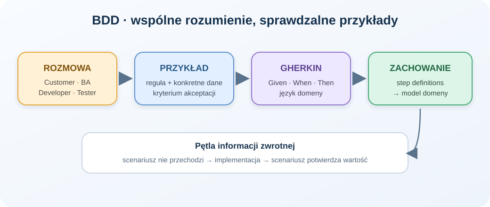
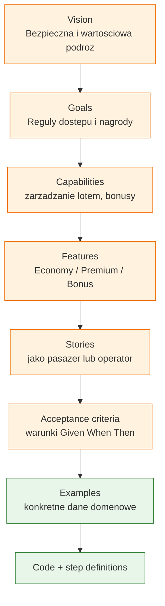
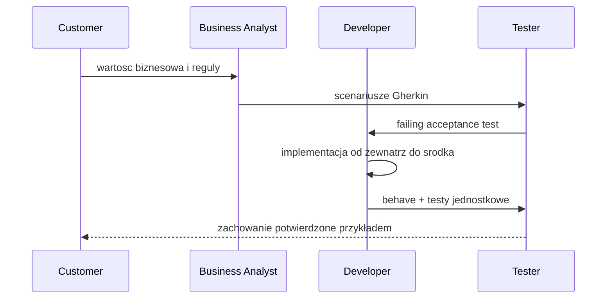

# Moduł 04 - BDD w Pythonie

Moduł pokazuje Behavior-Driven Development jako metodykę komunikacji
biznesu, analityka, dewelopera i testera. Gherkin opisuje przykłady językiem
bliskim domenie, a `behave` wykonuje je jako automatyzowane scenariusze.

## Cele dydaktyczne

Po module student powinien:

- przejść od Vision do Examples i kodu,
- wyjaśnić Outside-In jako rozwijanie systemu od zachowania użytkownika do
  współpracujących komponentów,
- pisać Feature, Scenario, Scenario Outline, Given, When, Then i And,
- organizować pliki `.feature` oraz step definitions w `features/steps/`,
- używać tabel Gherkina i parametrów scenariusza,
- budować domenowe kroki dla lotów ekonomicznych i premium,
- rozdzielać język biznesowy od technicznych szczegółów implementacji.

## Tematy

1. [01-bdd-outside-in](01-bdd-outside-in/README.md) - Business Value,
   Outside-In, współpraca Customer–BA–Developer–Tester oraz odpowiedzi do
   pytań kontrolnych i rozwiązania zadań.
2. [02-gherkin-language](02-gherkin-language/README.md) - składnia Feature,
   Scenario, Scenario Outline, Given, When, Then, And, tabele oraz
   wykonywalne rozwiązania zadań.
3. [03-behave-structure](03-behave-structure/README.md) - układ Behave,
   `environment.py`, `steps/`, kontekst, hooki, parametry i uruchamialny
   mini-projekt w katalogu `examples/`.
4. [04-passenger-flights](04-passenger-flights/README.md) - kompletna domena
   lotów: Economy, Premium, VIP, STUDENT, unikalność, bonus points, tabele
   pasażerów oraz przejście od przykładu do sprawdzonego zachowania.

## Hierarchia wymagań





## Pętla Outside-In



## Uruchamianie

```powershell
# Wszystkie testy pytest i testy BDD można uruchamiać osobno:
.venv\Scripts\python.exe -m pytest src\04-BDD -c src\04-BDD\pytest.ini -v

# Behave dla przykładu domenowego:
Push-Location src\04-BDD\04-passenger-flights
..\..\..\.venv\Scripts\python.exe -m behave -f pretty
Pop-Location

# Ruff:
.venv\Scripts\python.exe -m ruff check src\04-BDD
```

### Co uruchamia każde polecenie?

| Polecenie | Zakres | Rodzaj informacji |
|---|---|---|
| `pytest src\04-BDD ...` | testy domeny i testy rozwiązań | szybki feedback jednostkowy |
| `behave` w `04-passenger-flights` | `.feature` + `steps` + domena | przepływ akceptacyjny |
| `behave ... --tags=@premium` | wybrane scenariusze | diagnostyka funkcji |
| `ruff check src\04-BDD` | pliki Python | jakość i błędy stylu |

Przykład pełnego sprawdzenia z katalogu głównego:

```powershell
.venv\Scripts\python.exe -m pytest src\04-BDD -c src\04-BDD\pytest.ini -v
Push-Location src\04-BDD\04-passenger-flights
..\..\..\.venv\Scripts\python.exe -m behave -f progress
Pop-Location
.venv\Scripts\python.exe -m ruff check src\04-BDD
```

W `04-passenger-flights` pełny przepływ obejmuje pliki:

```text
features/*.feature
    -> features/steps/passenger_steps.py
    -> src/flight_domain.py
    -> Then / raport Behave
```

Testy `pytest` omijają parser Gherkina i bezpośrednio sprawdzają model oraz
helpers rozwiązań. Dlatego warto uruchomić oba narzędzia: jedno potwierdza
regułę jednostkową, drugie potwierdza zachowanie opisane językiem biznesowym.

## Mapa plików i materiałów do nauki

| Potrzeba | Gdzie szukać |
|---|---|
| Rozmowa o wartości i przykładzie | `01-bdd-outside-in/README.md` |
| Składnia i specyfikacja Gherkin | `02-gherkin-language/README.md` |
| Kod hooków, `context` i step definitions | `03-behave-structure/README.md` oraz `03-behave-structure/examples/` |
| Pełny przykład domenowy | `04-passenger-flights/features/` i `04-passenger-flights/src/` |
| Rozwiązania ćwiczeń Outside-In | `01-bdd-outside-in/exercises/` |
| Rozwiązania ćwiczeń Gherkina | `02-gherkin-language/exercises/` |
| Rozwiązania ćwiczeń domeny lotów | `04-passenger-flights/exercises/` |

Zalecany sposób pracy z każdym tematem:

1. przeczytaj opis problemu i pytania biznesowe,
2. zapisz lub przeczytaj konkretny scenariusz,
3. uruchom test w stanie wyjściowym i obejrzyj raport,
4. prześledź mapowanie kroku do kodu,
5. uruchom test jednostkowy odpowiedniej reguły,
6. dopiero potem porównaj własne rozwiązanie z plikiem `bdd_solutions_XX.py`.

W `04-passenger-flights` rozwiązanie statusu `STUDENT` używa reguły
`mileage // 15`, a tabela pasażerów mapuje kolumny `name` i `status` na
obiekty domenowe. Są to przykłady, które można rozbudować w kolejnych
ćwiczeniach.

## Scenariusz wykładu

| Czas | Etap | Treść |
|---|---|---|
| 0-15 min | BDD | różnica między wymaganiem, przykładem i testem |
| 15-30 min | Outside-In | hierarchia Vision → Code i współpraca ról |
| 30-45 min | Gherkin | czytelne Feature/Scenario/Examples |
| 45-60 min | Behave | mapowanie kroków do Python `steps/` |
| 60-82 min | Live coding | lot ekonomiczny i premium |
| 82-90 min | Podsumowanie | jakość scenariusza, refaktoryzacja kroków |

## Zadania

- dla każdego tematu wykonaj zadania z `exercises/`,
- dopisz co najmniej jeden scenariusz Gherkin przed implementacją,
- wyjaśnij, jaka wartość biznesowa jest chroniona przez scenariusz,
- uruchom zarówno `behave`, jak i testy jednostkowe domeny.
- sprawdź filtrowanie tagiem: `@premium` uruchamia wyłącznie scenariusze lotu premium.

## Literatura

- Dan North, *Introducing BDD*: <https://dannorth.net/introducing-bdd/>
- Cucumber Docs - Gherkin: <https://cucumber.io/docs/gherkin/reference>
- Behave Documentation: <https://behave.readthedocs.io/en/latest/>
- Martin Fowler, *Specification by Example*: <https://martinfowler.com/bliki/SpecificationByExample.html>
- Gojko Adzic, *Specification by Example*, Manning, 2011.
- Liz Keogh, *Behavior Driven Development*: <https://lizkeogh.com/behavior-driven-development/>
