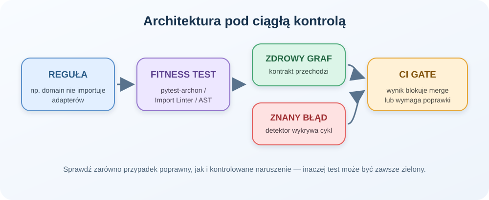

# Temat 05 - Architecture Fitness Functions

> Moduł: [06-ArchTest](../README.md) · Poprzedni:
> [04-architecture-lab](../04-architecture-lab/README.md)

## Cel

Utrwalić regułę architektoniczną jako automatyczną, powtarzalną kontrolę,
która działa przy każdej zmianie kodu. Fitness function powinna chronić
ważną właściwość architektury, dawać czytelny wynik i być sprawdzana zarówno
na prawidłowym projekcie, jak i na znanym przykładzie naruszenia.



## Od reguły do fitness function

Przykładowa właściwość: „moduł domeny nie zależy od warstwy web ani
infrastruktury”.

1. **Uzasadnij granicę** — oddzielenie reguł biznesowych od frameworków i I/O.
2. **Zapisz wykonywalny kontrakt** — pytest-archon lub Import Linter.
3. **Sprawdź poprawny graf** — oczekuj braku cykli i niedozwolonych importów.
4. **Sprawdź znane naruszenie** — test parsera wykrywa cykl w
   `03-architecture-rules/exercises/bad_architecture/`.
5. **Uruchamiaj kontrolę w CI** — regresja architektoniczna blokuje zmianę.

```text
kod zmieniony → fitness functions → wynik i raport → merge albo poprawka
```

Ważne: test wykrywający cykl w folderze z celowo błędnym przykładem powinien
**przechodzić**, ponieważ potwierdza, że detektor wykrył oczekiwane naruszenie.
Nie dodawaj tego folderu do głównego pakietu produkcyjnego ani do kontraktu
Import Linter dla poprawnej architektury.

## Przykład: pozytywna i negatywna kontrola cykli

W [test_import_cycles.py](../03-architecture-rules/examples/test_import_cycles.py)
graf importów jest budowany z AST, bez importowania modułów. Dzięki temu test
może bezpiecznie analizować nawet pliki, których wzajemne importy uniemożliwiłyby
ich normalne załadowanie:

```python
good_graph = import_graph(PACKAGE_ROOT)
assert has_cycle(good_graph) is False

known_bad_graph = import_graph(BAD_PACKAGE_ROOT, package_name="")
assert has_cycle(known_bad_graph) is True
```

Parser uwzględnia importy bezwzględne, względne oraz `from package import
submodule`. Sprawdzenie obu przykładów zmniejsza ryzyko, że test będzie zawsze
zielony z powodu błędu w samym detektorze.

## Uruchamianie lokalnie i w CI

```powershell
.venv\Scripts\python.exe -m pytest src\06-ArchTest -c src\06-ArchTest\pytest.ini -v
.venv\Scripts\python.exe -m ruff check src\06-ArchTest

Push-Location src\06-ArchTest\03-architecture-rules
$env:PYTHONPATH = Join-Path (Get-Location) "src"
..\..\..\.venv\Scripts\lint-imports.exe --config .importlinter
Remove-Item Env:PYTHONPATH
Pop-Location
```

Przykładowy job CI powinien uruchomić te same polecenia po instalacji
zależności. Nie twórz drugiej, rozbieżnej implementacji reguł tylko dla CI.

## Zadania

1. Dodaj fixture z niedozwolonym importem domeny i upewnij się, że test
   wykrywa go bez uruchamiania kodu fixture.
2. Dodaj regułę do grafu, która blokuje zależność `web -> infrastructure`.
3. Dodaj nową klasę `PaymentService` do `services/` i sprawdź automatycznie,
   że konwencja obejmuje ją bez edycji listy klas w teście.
4. Zdecyduj, które naruszenia są blokujące w CI, a które powinny najpierw
   generować raport ostrzegawczy.

## Pytania kontrolne

1. Co odróżnia fitness function od ręcznej checklisty?
2. Dlaczego warto sprawdzić detektor na znanym błędnym przykładzie?
3. Dlaczego negatywna fixture nie powinna znajdować się w pakiecie analizowanym
   przez kontrakt poprawnej architektury?
4. Które reguły powinny blokować merge?

## Literatura

- Neal Ford, Rebecca Parsons, Patrick Kua, *Building Evolutionary Architectures*.
- pytest-archon: <https://pypi.org/project/pytest-archon/>
- Import Linter: <https://import-linter.readthedocs.io/en/stable/>
